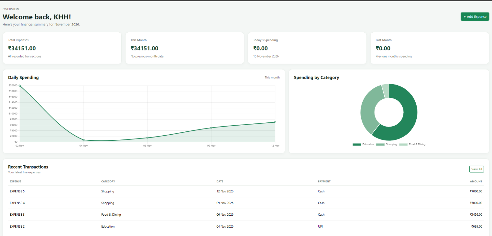
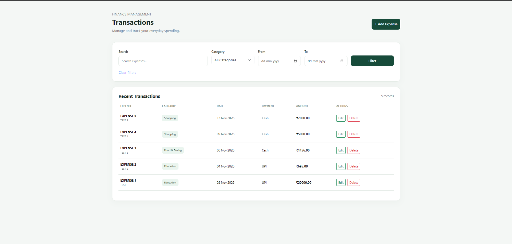

# PennyWise

<p align="center">
  
</p>

<p align="center">
  <strong>A simple, intuitive way to track expenses and understand your spending.</strong>
</p>

<p align="center">
  <a href="https://github.com/KrishH-KH/PennyWise">GitHub Repository</a> ·
  <a href="https://github.com/KrishH-KH/PennyWise/issues">Report an Issue</a> ·
  <a href="#getting-started">Getting Started</a> ·
  <a href="#screenshots">Screenshots</a>
</p>

<p align="center">
  
  
  
  
</p>

---

## Overview

**PennyWise** is a web-based personal expense management application developed using Python and Flask.

It provides a straightforward way to record everyday expenses, organize transactions by category, and review spending patterns through a visual dashboard.

The application is designed around a simple idea: managing personal finances should be clear, accessible, and easy to maintain.

## Features

- **User Authentication** — Register and log in with securely hashed passwords.
- **Expense Tracking** — Create, view, update, and delete expense records.
- **Category Organization** — Associate expenses with spending categories.
- **Interactive Dashboard** — Review expense summaries and recent transactions.
- **Spending Charts** — Visualize category-wise and daily expense activity.
- **Monthly Overview** — Review monthly spending information.
- **INR Currency Support** — Display expense amounts in Indian Rupees.
- **Form Protection** — Use CSRF protection for supported forms.

## Screenshots


### Dashboard



### Expense Management



### Login


## Technology Stack

| Area | Technology |
|---|---|
| Backend | Python, Flask |
| Frontend | HTML5, CSS3, JavaScript |
| UI Framework | Bootstrap 5 |
| Charts | Chart.js |
| Database | SQLite |
| ORM | Flask-SQLAlchemy |
| Migrations | Flask-Migrate |
| Authentication | Flask-Login |
| Forms | Flask-WTF, WTForms |
| Environment Configuration | python-dotenv |

### Useful Documentation

- [Python](https://docs.python.org/3/)
- [Flask](https://flask.palletsprojects.com/)
- [Flask-SQLAlchemy](https://flask-sqlalchemy.palletsprojects.com/)
- [Flask-Migrate](https://flask-migrate.readthedocs.io/)
- [Flask-Login](https://flask-login.readthedocs.io/)
- [Bootstrap](https://getbootstrap.com/docs/5.3/)
- [Chart.js](https://www.chartjs.org/docs/latest/)
- [SQLite](https://www.sqlite.org/docs.html)

## Project Structure

```text
PennyWise/
│
├── app.py
├── config.py
├── requirements.txt
├── seed_categories.py
├── .env.example
│
├── forms/
│   ├── __init__.py
│   ├── auth_forms.py
│   └── expense_forms.py
│
├── models/
│   ├── __init__.py
│   ├── user.py
│   ├── expense.py
│   ├── category.py
│   └── budget.py
│
├── routes/
│   ├── __init__.py
│   ├── auth.py
│   ├── dashboard.py
│   ├── expenses.py
│   ├── budget.py
│   ├── categories.py
│   └── reports.py
│
├── migrations/
│   └── versions/
│
├── templates/
│   ├── auth/
│   ├── dashboard/
│   ├── expenses/
│   └── base.html
│
├── static/
│   ├── css/
│   └── js/
│
└── docs/
    └── images/
```

## Getting Started

Follow these instructions to set up PennyWise on your local machine.

### Prerequisites

- Python 3 installed
- Git installed
- pip package manager

### 1. Clone the repository

```bash
git clone https://github.com/KrishH-KH/PennyWise.git
cd PennyWise
```

### 2. Create a virtual environment

```bash
python -m venv venv
```

Activate it on Windows:

```bash
venv\Scripts\activate
```

### 3. Install dependencies

```bash
pip install -r requirements.txt
```

### 4. Configure environment variables

Create your local environment file:

```bash
copy .env.example .env
```

Open `.env` and replace the placeholder secret key with a secure value.

You can generate one using:

```bash
python -c "import secrets; print(secrets.token_hex(32))"
```

Your `.env` should contain:

```env
SECRET_KEY=your-generated-secret-key
DATABASE_URL=sqlite:///pennywise.db
```

**Never commit your `.env` file or share your secret key.**

### 5. Initialize the database

Apply the database migrations:

```bash
flask --app app db upgrade
```

### 6. Add default expense categories

```bash
python seed_categories.py
```

### 7. Start the application

```bash
python app.py
```

Open your browser and visit:

**http://127.0.0.1:5000/**

## Security

PennyWise includes several basic security measures:

- Password hashing through Werkzeug.
- CSRF protection through Flask-WTF.
- Environment-based secret configuration.
- Local database and environment files excluded from version control.

This project is intended for learning and development. Review and strengthen its security before using it to store real financial information.

## Future Improvements

Potential areas for further development:

- Budget creation and tracking workflows.
- More detailed spending reports.
- Expense data export.
- Additional financial insights.
- Further UI and accessibility improvements.

## Contributing

Suggestions, bug reports, and improvements are welcome.

1. Fork the repository.
2. Create a feature branch.
3. Make your changes.
4. Submit a pull request.

For bugs or suggestions, [open an issue](https://github.com/KrishH-KH/PennyWise/issues).

---

<p align="center">
  <strong>PennyWise — Track. Manage. Save.</strong>
  <br>
  Built with Python and Flask.
</p>
